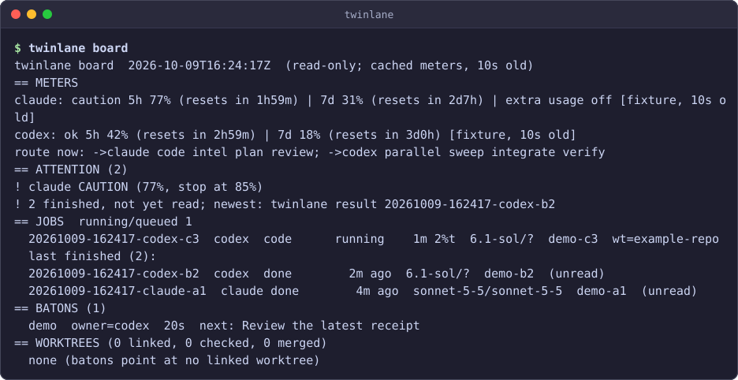

# twinlane

**Claude Code + Codex. One workflow.**

Run Claude Code and Codex together on your included subscriptions, with usage-aware routing, saved handoff briefs, and background jobs with receipts.

When one engine approaches its usage limit, the other may still have allowance. twinlane brings both readings into one view, helps route the next task, and keeps a local record of the work.

Works with Anthropic's Claude Code CLI and the OpenAI Codex CLI on Windows, macOS and Linux. Use it when you keep hitting Claude Code usage limits or Codex rate limits mid-task, when you want parallel AI coding agents in separate git worktrees, or when you need a guardrail hook that keeps an autonomous coding agent inside its worktree.

[](https://github.com/mmelqadi/twinlane/actions/workflows/ci.yml)
[MIT license](LICENSE) · [Latest release](https://github.com/mmelqadi/twinlane/releases/latest) · Python 3.9+ · Standard-library runtime

## What you can do

- **See both usage limits.** Check Claude Code and Codex windows together, including the window currently limiting each engine.
- **Route new work.** Choose an engine by task type, fresh usage readings, and your configured thresholds.
- **Prepare a handoff.** Save the task's goal, progress, decisions, and recent evidence in a brief for the next engine.
- **Inspect delegated work.** Background jobs leave event logs, final results, and receipts you can review locally.
- **Land and ship deliberately.** A single-integrator land queue with a gate, a release manifest for exactly what landed, worktree health checks, best-of runs across engines, and restart recovery for lost jobs (see the sections below).

If a dispatched worker ends with a recognized usage-limit result, twinlane can make one policy-checked attempt on the other engine, carrying the original brief, available partial output, and worktree changes. This is a new attempt; it does not migrate a running conversation.

### Preview the board

The image and runnable demo below use **simulated usage and job data**. They show the board without contacting a vendor.



## Try the demo

With Git and Python 3.9+ installed:

```sh
git clone https://github.com/mmelqadi/twinlane.git
cd twinlane
python examples/demo/run.py
```

The demo creates disposable fixture data and removes it when finished. You do not need subscriptions, installed agent CLIs, or a pipx installation to preview the board. Use `python3` if that is your Python command.

## Quickstart

### 1. Install for live work

From the source checkout above, with pipx installed:

```sh
pipx install .
```

For an installation without a source checkout, use `pipx install git+https://github.com/mmelqadi/twinlane`. The example briefs below are in the source checkout.

Live workers need the installed `claude` and `codex` CLIs, signed into the accounts you intend to use. Check your installed CLI versions and configure model names for your accounts.

Refresh the usage readings and inspect the routing decision:

```sh
twinlane meter --fresh
twinlane route intel
```

If an engine reads `unknown`, follow the displayed reason before starting work. On macOS/Linux, set `TWINLANE_CODEX_BIN` to your Codex binary or use available rollout evidence; automatic Codex desktop discovery is Windows-specific. See [Limits](LIMITS.md) for platform and authentication details.

If the Claude CLI login has expired, renew that login and run `twinlane meter --fresh` again. `--fresh` rereads usage; it does not renew credentials or make a model call. You can also supply a usage reading with `twinlane meter --record-claude <get_usage json>`.

### 2. Run a first read-only task

From the twinlane source checkout, use the included brief to inspect this repository:

```sh
twinlane run --kind intel --cd . --brief examples/briefs/first-review.md
twinlane board
```

The `intel` profile requests read-only work. Inspect the returned job ID with `twinlane result JOB`, replacing `JOB` with that ID.

To inspect your own repository, change `--cd` to its path and supply a brief file describing your task.

### 3. Try a writing task in a linked worktree

Writing jobs require a **linked Git worktree**. From the twinlane source checkout:

```sh
git worktree add ../twinlane-first-task -b twinlane-first-task
twinlane run --kind code --cd ../twinlane-first-task --brief examples/briefs/first-change.md --write --bg
```

The included brief asks for one small documentation improvement. Use a different branch and directory name if those already exist. After the job starts, inspect its ID with `twinlane wait JOB` and `twinlane result JOB`, then review the worktree diff yourself.

### Optional: interactive usage warnings

The advisory Claude hook is optional for dispatching workers. Preview it before applying it:

```sh
twinlane install              # preview the hook change
twinlane install --yes        # apply it to your Claude settings file, with backup
```

Credits and extra usage are checked only when a job starts. A long Codex job can still reach paid credits if your account allows it. See [Money guard](#money-guard) and [Limits](LIMITS.md) before running live jobs.

## Usage and routing

| Kind | First | Fallback |
| --- | --- | --- |
| `code`, `intel`, `plan`, `review` | Claude Code | Codex CLI |
| `parallel`, `sweep`, `integrate`, `verify` | Codex CLI | Claude Code |

The default thresholds are caution at 75%, prepare a handoff at 80%, stop new nonurgent work at 85%, and hard stop at 100%. An unknown or stale reading is **unknown**, never 0%; it cannot authorize that engine.

Every usage window of both engines counts: Claude's 5-hour, weekly and per-model windows, and each Codex limit. The meter and the board list each window and mark the one that sets the engine's maximum `[binding]`; a window twinlane does not know keeps its own name with `(unrecognised window)`. Every refusal names the window that caused it, for example `claude stop (90% in 7d-sonnet)`, and `--json` carries the same facts as `blockers`. When the first-choice engine is at 75-85% and the other is below 75% and usable, `twinlane route` picks the other one and says so.

### Money guard

Credits and extra usage are checked only when a job starts. A long Codex job can still reach paid credits if your account allows it; twinlane passes no option that enables credits.

- Claude: dispatch is refused while paid extra usage is ON, and also while its state is unknown. An unknown state is held as `unknown` with the reason shown by `twinlane route`, `twinlane meter` and the board, and `twinlane meter --record-claude <get_usage json>` clears it. The optional automatic token refresh (off by default, `meter.auto_refresh_claude`) makes its one small model call only when the last recorded reading shows extra usage OFF.
- Codex: before every attempt, a failover included, twinlane refuses for every model when the Codex reading is missing, unknown, older than `codex.preflight_max_age_s` (300 s), on credits, past its included usage or spend-capped. The refusal names the model.
- Setting `claude.extra_usage_allowed` or `codex.allow_credits` to true in config allows those jobs and prints a warning that charges may apply. There is no per-job credits flag.

## Workers and receipts

`twinlane run` accepts `--engine`, `--kind`, `--cd`, `--brief`, `--bg`, `--write`, `--name`, `--baton`, `--effort`, and `--timeout`. A code worker can edit its selected worktree; an intel worker gets a read-only profile. Background jobs have an ID, an evidence directory, event stream, final message, usage information where reported, and a receipt. Use `twinlane wait JOB --any`, `twinlane result JOB`, or `twinlane stop JOB`.

Codex uses the installed CLI through `codex exec --json`. `TWINLANE_CODEX_RUN` can name an optional compatible adapter. No adapter is required. Evidence includes `events.jsonl`, `last-message.md`, and `result.txt`.

A code worker, Claude or Codex, starts without any environment variable whose name looks like a secret (TOKEN, SECRET, PASSWORD, API_KEY, `*_KEY`, AWS_*, AZURE_*, GH_*, OPENAI_*, ...). The receipt's `env_stripped` lists the stripped names, never their values. A secret a script reads from a file is not removed.

Job liveness has three values: alive, dead and unknown. A process that exists but whose creation time cannot be read (a restricted-token sandbox cannot open the host's runners) makes its job `unknown`, never `lost`. An `unknown` job keeps its engine's slot, stays on the board and in the baton, blocks `--continue-job`, and `twinlane stop` will not kill it; check it from the host. After a kill at a timeout or an interrupt, the runner checks the process it started (the Claude CLI, or the Codex runner) instead of trusting the kill command. A process that is still running is recorded in `jobs/<id>/survivor.json` and the job stays `orphaned` (or `unknown`) until `twinlane stop` ends it. `twinlane run --resume SESSION` is refused while the tracked job that owns that session is live or unknown.

On Windows, every `--bg` runner is created through WMI (`detach=wmi`), outside every job object of the launching app and outside its process tree. If WMI cannot start it, `--bg` is refused (exit 3) rather than falling back to a start that could die with the app. macOS and Linux keep their own path: a new process session and process-group stop.

## Batons, board, and sessions

`twinlane baton new SLUG --goal "..."` starts a local task record. `baton set`, `baton snap`, and `baton show` maintain it. `twinlane handoff SLUG --to codex` writes a brief using the task record and recent evidence. Approvals never transfer with a brief.

A baton is capped at 8 KB by trimming the oldest finished history. An unfinished job is never trimmed, so many live jobs can leave a baton over 8 KB, and a handoff lists every unfinished job id or ends with an exact count of the ones it left out. Worker receipts update a baton's job and in-flight fields but never its `owner` (the lead); only `twinlane baton set --owner` changes that.

`twinlane board --md` is a read-only view of cached usage, routing, live and finished jobs, batons, and linked worktrees. `twinlane sessions` lists open or recent Claude Code and Codex CLI sessions available for forwarding. The demo below is generated from a disposable fake home by `python examples/demo/run.py`:

```text
twinlane board  2026-10-11T10:15:33Z  (read-only; cached meters, 10s old)
== METERS
claude: caution 5h 77% (resets in 1h59m) [binding] | 7d 31% (resets in 2d7h) | extra usage off [fixture, 10s old]
codex: ok 5h 42% (resets in 2h59m) [binding] | 7d 18% (resets in 3d0h) [fixture, 10s old]
route now: ->codex code* intel* plan* review* parallel sweep integrate verify  (* = fallback)
== ATTENTION (2)
! claude CAUTION (77% in 5h, stop at 85%)
! 2 finished, not yet read; newest: twinlane result 20261011-101533-codex-b2
== JOBS  running/queued 1
  20261011-101533-codex-c3  codex  code      running    1m 2%t  6.1-sol/?  demo-c3  wt=example-repo
  last finished (2):
  20261011-101533-codex-b2  codex  done        2m ago  6.1-sol/?  demo-b2  (unread)
  20261011-101533-claude-a1  claude done        4m ago  sonnet-5-5/sonnet-5-5  demo-a1  (unread)
== BATONS (1)
  demo  owner=codex  20s  next: Review the latest receipt
== WORKTREES (0 linked, 0 checked, 0 merged)
  none (batons point at no linked worktree)
```

## Landing finished work

`twinlane land` lets one integrator land worktree branches into the target branch one at a time. Each repository (identified by its main checkout) has one first-in-first-out queue and one integrator lock.

```sh
twinlane land enqueue my-task --worktree ../app-my-task    # append the branch to the queue
twinlane land status                                       # queue and lock holder
twinlane land run --dry-run                                # print the checks; no lock, no writes
twinlane land run                                          # land the head of the queue
```

`land run` runs the project's `land.gate` in the slug's worktree on the tree that will land, then fast-forwards the target branch. A failing gate lands nothing, and a gate that moves `HEAD` or changes the tree is refused. If the target moved, `--rebase` rebases a linear branch first; a range that holds merge commits is never rebased. Every outcome (landed, refused, failed, broken lock) is appended to a ledger that records the exact commit range.

The lock is held by the running `land run` process and carries a token and a heartbeat. A live holder is never taken, even with a stale heartbeat. A provably dead holder is cleared only with `twinlane land release --break --reason "..."` (or `land run --break --reason "..."`); a holder whose liveness cannot be judged is never broken. Other subcommands: `next`, `dequeue SLUG`, `log [SLUG]`. Add `--json` for machine-readable output. Exit codes: 0 ok, 2 usage, 3 refused, 4 lock held, 5 gate or land failed. Workers cannot run `land`; run it from the lead session.

## Shipping landed work

`twinlane ship` never ships by default. It turns a landing into a manifest and runs the command you configured, behind a dry run.

```sh
twinlane ship plan my-task                         # manifest of the slug's latest landing
twinlane ship plan abc1234..def5678                # or an explicit commit range
twinlane ship run --manifest PATH                  # dry run: runs ship.dry_run_command, writes a receipt
twinlane ship run --manifest PATH --execute --confirm 1a2b3c4d
```

`ship plan` lists the exact files of the range (path, sha256 and size of the bytes a checkout of the source commit produces), the deleted paths and the commits. Commits that are not the slug's are flagged as foreign, and paths that later commits changed again are flagged as superseded; the plan is refused unless you pass `--allow-foreign` or `--allow-superseded`. `--baseline REF` names what is already shipped; `--landing N` picks which landing of the slug (1 is the first, -1 the last).

`ship run --execute` needs a configured `ship.command`, a passing dry-run receipt for the same manifest that is younger than `ship.dry_run_max_age_s` and not used yet, and `--confirm` equal to the first 8 hex digits of the manifest sha256. A receipt is good for one execute. A manifest is accepted only in the exact canonical bytes `ship plan` writes. Without `ship.command`, `ship run` only prints the manifest path and exits 3. Workers cannot run `ship run`.

## Worktree health

```sh
twinlane wt doctor [--all] [--md | --json]    # read-only report
twinlane wt prune                              # dry run
twinlane wt prune --yes [--include-empty]      # remove what passed every check
```

`wt doctor` reports each linked worktree: merged, unlanded, empty, detached or missing; stale; uncommitted changes; what uses it (a live job, a baton, a land queue entry); missing or dangling dependency folders; and the Windows long-path risk. `--all` also covers every project in your config.

`wt prune` is a dry run unless `--yes`. It removes a worktree only when its branch is merged and had commits of its own, it is clean, nothing uses it, and its last activity is older than `wt.prune_min_age_s`. Links (junctions and symlinks) inside it are unlinked first, without being followed. The branch is deleted with `git branch -d` only; an unmerged branch is never deleted. Every action is recorded in `prune.jsonl`. Workers cannot run `prune`.

## Best-of runs

```sh
twinlane run --best-of claude,codex@sol-high --brief task.md --cd . --write
twinlane compare GROUP --wait --test
```

`run --best-of` starts the same brief on several engines (at most `best_of.max_contestants`, default 3). Each contestant is an ordinary background job, so the meters and the money guard apply to every one, and none fails over to the other engine. N contestants spend N times the usage. A write contestant gets its own worktree and branch cut from `--base` (default `HEAD`); read-only contestants share `--cd`. `--dry-run` shows the plan.

`twinlane compare GROUP` lists each contestant's receipt and diff; `--wait` waits for the jobs, `--test` runs the project's configured `test` command in each worktree. Nothing is picked or merged for you. `compare GROUP --discard` (dry run unless `--yes`) removes only that group's empty worktrees, through the same checks as `wt prune`.

## Resuming lost jobs

`twinlane resume` lists background jobs whose status is exactly `lost`, typically after a reboot or an app quit, with the likely cause when the host's boot time shows one. It never runs on its own. `twinlane resume JOB...` or `--all-lost [--since 48h]` selects jobs; `--yes` continues each one once (`run --continue-job`), at most `resume.max_batch` (default 10), and stops at the first refusal. A job that is `unknown`, `orphaned` or running is never resumed, because it may still be alive. A resumed job is marked in `jobs/<id>/resumed.json` and is not resumed twice.

## Per-project configuration

Land, ship, worktree and best-of behaviour is set per repository in the `projects` map of your **user** config, keyed by the main checkout's path. It is never read from the repository itself, so a worker inside a checkout cannot rewrite the gate or ship command that judges its work.

```json
{
  "projects": {
    "/srv/app": {
      "land": {"target": "main", "gate": ["make", "check"]},
      "ship": {"dry_run_command": ["make", "release-dry-run", "MANIFEST={manifest}"],
               "command": ["make", "release", "MANIFEST={manifest}"]},
      "wt": {"deps_dirs": ["node_modules"], "stale_days": 7},
      "test": ["make", "test"]
    }
  }
}
```

Commands are argv lists, never strings; nothing runs through a shell. Placeholders are `{repo}`, `{worktree}`, `{branch}`, `{slug}`, `{target}`, `{manifest}`, `{source_commit}` and `{base}`; an unknown placeholder is an error, and a value with a line break is refused. A `.bat` or `.cmd` command only receives plain values. Other keys: `land.command`, `land.command_rebases`, `land.heartbeat_s`, `land.heartbeat_stale_s`, `land.gate_timeout_s`, `ship.dry_run_max_age_s`, `wt.root`, `wt.setup_command`, `wt.remove_command`, `wt.link_roots`, `wt.prune_min_age_s`. Unknown keys are refused. Without a `land.gate`, `land run` lands ungated and says so.

## Configuration

`TWINLANE_HOME` overrides the data directory. Otherwise Windows uses `%LOCALAPPDATA%/twinlane`; macOS and Linux use `$XDG_DATA_HOME/twinlane` or `~/.local/share/twinlane`. The directory holds `state/`, `jobs/`, `batons/`, and `bin/`. `TWINLANE_CONFIG` selects a user JSON file; otherwise twinlane reads `<home>/config.json`. User values merge recursively over the packaged `policy.json`.

`CLAUDE_CONFIG_DIR` and `CODEX_HOME` select the Claude and Codex configuration directories. `TWINLANE_CODEX_BIN` selects the Codex binary for the runner and the meter. `twinlane install` previews the resolved Claude settings path before `--yes` writes it.

The optional adapter named by `TWINLANE_CODEX_RUN` receives `--brief PATH --cd DIR --tier TIER --out DIR --timeout SECONDS`, optional `--model MODEL --effort EFFORT`, and `--write` for a code job. It receives `TWINLANE_CODEX_ADAPTER_STRICT_CREDITS=1` and `TWINLANE_CODEX_BIN` when available. It must write `<out>/events.jsonl`, `<out>/last-message.md`, and `<out>/result.txt`; it must exit nonzero on refusal or failure. The strict credits variable asks the adapter to refuse paid credits. The packaged runner does not need this adapter.

Add local deny rules in your own config, for example:

```json
{"claude": {"deny": ["Bash(my-release-command:*)", "PowerShell(my-release-command*)"]}}
```

Arrays replace the packaged array; include the generic rules you still need. Do not put credentials in the config file.

Guard settings go in the `guard` section: `deny_commands` (program names, optionally with leading arguments), `deny_text` (regular expressions matched against the command text), `self_aliases` (extra names for the twinlane command) and `allow_subagents` (default false). A `guard` section that is not an object, or cannot be read, denies every call of the job.

Codex settings: `codex.binary_source` is `auto` (default: the desktop app's private copy when there is one, else `codex` on PATH), `app-copy` or `path`; `TWINLANE_CODEX_BIN` overrides it in every mode. `codex.min_cli_version` (`X.Y.Z`) refuses a binary that is older or whose version cannot be read. `codex.exec_config` is a list of `"key=value"` strings passed to `codex exec` as `-c`; it may not set the model, its effort, the sandbox or the approval policy, which twinlane sets per job.

Installer options: `twinlane install --check` is a read-only report (one hook expected, shims, skills). `--unhook` removes only twinlane's hook entry. `--hook-command CMD` registers or recognises a custom hook command. `--alias NAME[,NAME]` writes command shims into `--bin-dir` (default `~/.local/bin`); `--replace` backs up and replaces a shim twinlane did not write. `--skill DIR` writes the packaged `SKILL.md` into `DIR`. Every write is a preview until `--yes`.

## Platform and security

Windows has detached background workers and process-tree stop support. POSIX workers detach with a new session and stop their process group. Windows job-object details have no POSIX equivalent. The WMI start was tested with synthetic job-close and tree-kill tests and with real quit-and-reopen tests of the Claude and Codex desktop apps on one Windows machine and build: the runners and engines kept running. That shows survival on that tested setup only; it is not a general guarantee, and it says nothing about whether the task itself succeeds. Sign-out, shutdown, sleep and reboot were not tested. The Codex app-server meter currently finds only the Windows Codex desktop app. It copies a complete app-server build into `<home>/bin`, keeping at most 3 copies of about 434 MB each (about 1.3 GB total). On Linux/macOS, set `TWINLANE_CODEX_BIN` or rely on rollout files. Otherwise the Codex meter reads **unknown**, and parallel/sweep routes fail safe to Claude or refuse.

`twinlane install` registers an advisory hook for interactive sessions. The blocking guard only acts inside twinlane-dispatched workers; interactive sessions are NOT guarded. The guard is a heuristic over shell text, not a sandbox. It parses each shell command a worker runs and denies git history, ref and config writes (commit, push, pull, merge, rebase, reset, revert, tag, `stash` other than list/show, `notes` writes, `config` writes, `submodule foreach`, program options such as `--upload-pack`), outbound sends (curl/wget/Invoke-WebRequest with a body, a non-GET method or a non-local host, mail clients, ssh/scp/rsync to a host, `gh` writes, cloud CLIs, package publishing), nested engine launches, and in the code profile paths outside the worktree: any path named by a write command, a redirect or an output option (`-o`, `--output`, `--target-dir`, ...), and a `..` or home path named by any command that is not on a short read-only list (so `chmod`, `sed --in-place` or `perl -pi` on `../x` are denied without being listed). Archive extractors run only with options known to keep member names inside the destination. It follows wrappers (`env`, `sudo`, `timeout`, `xargs`), `env -S`/`env -C`, git config passed through the environment, and code given inline to an interpreter. It does not read script files, and a command obfuscated in a way it does not model can still pass: quoting beyond simple concatenation, aliases and functions, a bare `$CMD`, a script written and then run, lookalike Unicode in a command name. It also denies database clients, program runners and nested shells, git ref writes, PowerShell execution and persistence commands (scheduled tasks, crontab), twinlane commands that dispatch or mutate, and any write to the worktree's `.git`; file-tool paths must be literal (`~`, `$VAR` and URLs are refused). The guard is defense in depth, not confinement: see [Limits](LIMITS.md). A command too long or too complex to inspect is denied, and if the guard itself cannot load inside a job it blocks the call (exit 2). The meter reads local CLI credentials and vendor usage information. Its Claude endpoint is undocumented and may change; redirects are refused so the token stays on the original host. No API key router is used.

## What this is not

twinlane is not an API-key router or a multi-model chat UI. It coordinates two installed CLIs and stores evidence locally.

## Related work

- `amElnagdy/delegate-skills`: discovery and setup for 17 CLIs.
- Claude/Codex orchestrator, delegate, and handoff projects: single-direction delegation or file handoffs.
- `ccusage`: Claude token and cost reports.

## Tests and license

Run `python -m unittest discover -s tests -v`. Tests use fixtures and temporary homes; they do not call vendor networks. MIT licensed; see [LICENSE](LICENSE).
